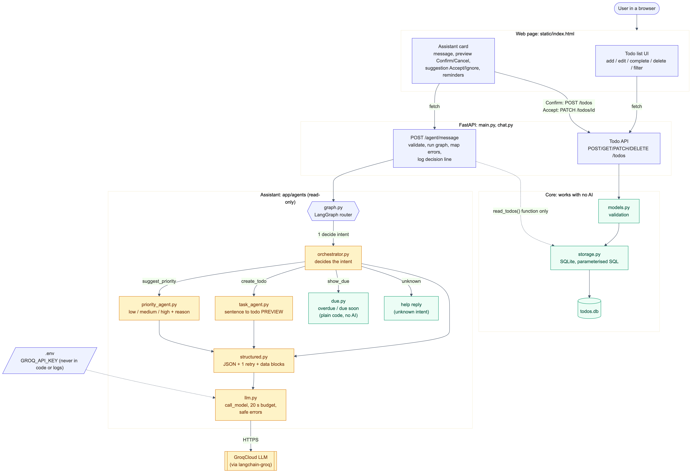
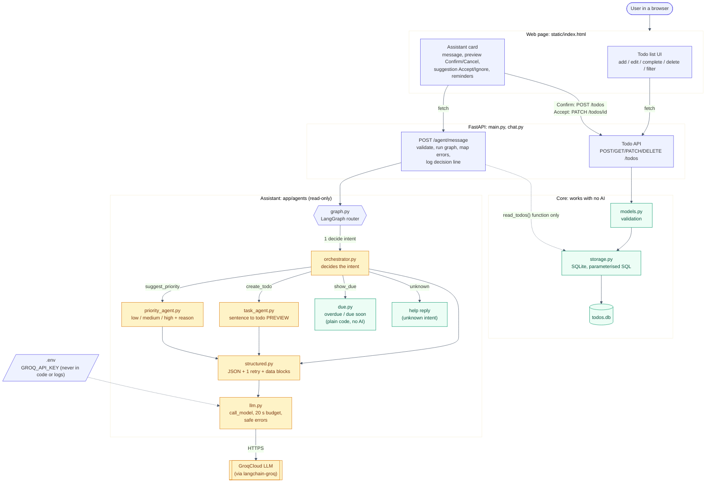

# Architecture: Agentic Todo App

The same architecture is used by all three builds (OpenSpec, Spec Kit, HVE). Only the paper trail and the look of the page differ.

(The diagram source is `architecture.mmd`; `architecture.svg` is the same picture as a scalable file. GitHub and VS Code
also draw the Mermaid below directly.)

## How to read it

- **Blue** boxes are the app's plumbing (page, routes, router). **Amber** boxes use the AI model. **Green** boxes are plain
  code and data with no AI.
- **Core (right)** is a normal todo app: the page calls the Todo API, `models.py` validates, `storage.py` talks to SQLite.
  It works with no key and no internet.
- **Assistant (left)** is added on top. A message goes to `POST /agent/message`, then a LangGraph router asks the
  orchestrator for the intent, then exactly one of four things runs:
  `task_agent` (sentence to a todo *preview*), `priority_agent` (suggestion), `due.py` (exact reminder list, plain code) or a help reply.
- **Every AI call** goes through `structured.py` (ask for JSON, check it, retry once, wrap user text as data) and `llm.py`
  (one door to Groq with a 20 second budget and safe errors). The key lives only in `.env`.

## The one rule the diagram shows

The assistant is **read-only**. The dotted line from the chat route to `storage.py` carries only a `read_todos()` function;
the agents never import the storage module. Anything the assistant proposes becomes a real change only when you press
**Confirm** or **Accept** on the page, which sends a normal `POST /todos` or `PATCH /todos/{id}` (the line from the
Assistant card to the Todo API). Tests fail if an agent ever gains a way to write.

## Walk-through: "call mom tomorrow at 5pm"

1. The Assistant card sends the text to `POST /agent/message`.
2. The route validates it (1 to 500 characters) and starts the 20 second budget.
3. The graph asks the orchestrator, which answers `create_todo`.
4. `task_agent` asks the model for JSON (title, due date, priority), checked against a printed calendar for weekday dates.
5. The page shows a **preview**. Nothing is saved yet.
6. You press **Confirm**: the page calls `POST /todos`, and only then is the todo stored in `todos.db`.
