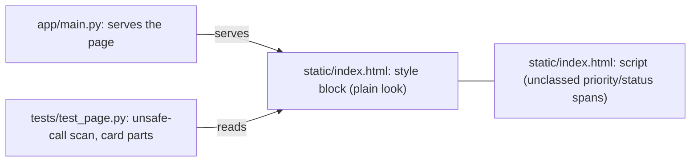
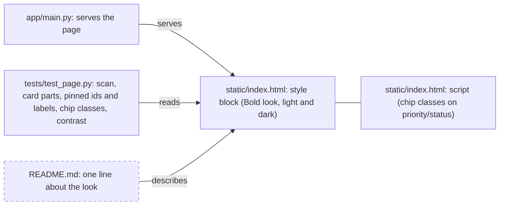
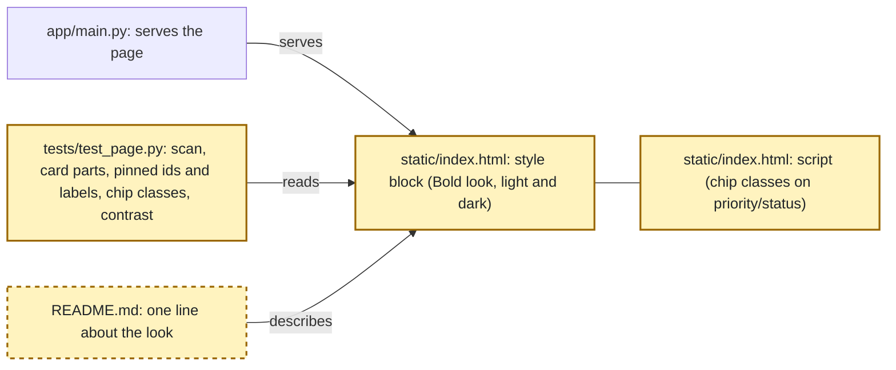

<!-- markdownlint-disable-file -->
# RPI Plan: Bold UI theme (HVE build)

## Task Metadata

* Task ID: bold-ui-theme
* Task slug: bold-ui-theme
* Plan date: 2026-10-20

## Executive Summary

* Bottom line: Give the HVE page its own "Bold" look in one small phase: a clean light base with large rounded cards in a responsive grid, a violet-to-pink gradient on primary buttons and a gradient bar under a big friendly heading, colourful priority chips (high red, medium amber, low green) that still say the word, and a matching dark variant. Tests come first, then the CSS, then one small script edit that puts a class on the priority and status spans, then a real-browser check.
* Why this matters: The three builds look alike today. A distinct look makes the comparison visible, and the guards (pinned ids and labels, a contrast test that covers both gradient colours) keep the change from breaking anything.
* Planning result: Complete and ready for implementation. The independent critique found no blocking problems (2 Medium, 1 Low, all corrected).
* Confidence and uncertainty: High that this is a small, safe change (research C1, C2). Medium on the final colours, which the contrast test will settle.

### What You May Not Know

* Priority and status are plain unclassed text today (research C2), so coloured chips need one small script edit, not only CSS.
* A gradient means contrast depends on both colours, so the contrast test checks both ends in light and dark (research C5). The heading will be solid text with a gradient bar, because gradient-clipped text cannot be tested for contrast.
* The browser scripts live outside the project (session scratchpad) and rely on the visible words, so the words stay the same (`Priority: High`).

## Phase Checklist

### Before

### After

The page keeps its structure; its style block is replaced, the script gains classes, the page tests gain pins and a contrast check, and the README gets a line. The README is the only new node; the rest are changed.

<!-- rpi:phase id=P01 -->
### [x] P01: Bold look on the page

Goals:
* The page has a distinct "Bold" identity in light and dark with no change in behaviour, guarded by tests that fail if an id, a label, the plain-text rule or the contrast regresses.

Dependencies:
* None

Highlighted work: all five nodes are changed or added in this phase.

<!-- rpi:task id=P01-T01 -->
#### [x] P01-T01: Tests first: pins, chip classes and contrast

Goals:
* Tests that pin everything that must not change and describe the new look, written and seen failing before any restyle.

Requirements:
* NFR-001, NFR-003, NFR-004, FR-003
* Colour variable contract (binding, so the tests and the CSS agree): `--bg`, `--card`, `--text`, `--muted`, `--accent-a`, `--accent-b`, `--accent-text`, and for each priority `--chip-high-bg`, `--chip-high-text`, `--chip-medium-bg`, `--chip-medium-text`, `--chip-low-bg`, `--chip-low-text`; light values in `:root`, dark values in one `@media (prefers-color-scheme: dark) { :root { ... } }` block; all `#rrggbb`.
* Pin every element id the script uses and the visible labels, keep the unsafe-call scan, and add: priority and status spans carry classes (`chip` plus the priority or status word); a card-grid rule that cannot exceed a phone screen; and a contrast test reading the colour variables for light and dark: text, muted text, text on **both** gradient colours, and each chip's text on its chip colour, all at least 4.5 to 1, with a self-test of the helper.

Details:
* File: `tests/test_page.py` (extend; `tests/` files mirror modules, and this one already covers the page). Names follow `test_given_..._when_..._then_...` with Arrange/Act/Assert.
* The pinned id list can be read from the page and from the browser script (research C3): `add-title`, `add-desc`, `add-due`, `add-priority`, `add-error`, `add-form`, `filter-status`, `filter-priority`, `list-error`, `todo-list`, `chat-form`, `chat-input`, `chat-send`, `chat-status`, `chat-error`, `chat-reply`, `chat-result`.
* Maximum additions: this one file. Removals: none.
* Run the new tests and confirm the look and chip tests fail while the pin tests pass.

References:
* [tests/test_page.py](../../../tests/test_page.py): existing page tests
* [.github/instructions/todo-app/web-page.instructions.md](../../../.github/instructions/todo-app/web-page.instructions.md): page rules
* [.github/instructions/coding-standards/python-tests.instructions.md](../../../.github/instructions/coding-standards/python-tests.instructions.md): test style
* [.copilot-tracking/research/2026-10-20/bold-ui-theme-research.md](../../research/2026-10-20/bold-ui-theme-research.md):
  * Findings 3 and 4 and evidence C3 and C5

Dependencies:
* None

<!-- rpi:task id=P01-T02 -->
#### [x] P01-T02: Restyle the page (CSS)

Goals:
* The page looks Bold: light base, large rounded cards in a grid that is one column on a phone, gradient primary buttons and heading bar, a big friendly heading, and a dark variant.

Requirements:
* FR-001, NFR-001, NFR-002, NFR-005
* Exactly the colour variables listed in the contract in P01-T01 are declared in `:root` and in the dark block, so the contrast test can read them. Colours are `#rrggbb` values. No new library, font file or framework.

Details:
* File: `static/index.html`, the `<style>` block only. Illustrative starting colours (not binding; the contrast test decides): light page `#f7f5ff`, card `#ffffff`, text `#1f1b2e`, gradient `#6d28d9` to `#be185d`; dark page `#14111f`, card `#1d1830`, text `#f0ecff`, gradient `#a78bfa` to `#f472b6` with dark button text.
* Heading is solid text with a gradient accent bar under it (not gradient-clipped text). The grid uses a minimum card width that is capped by the screen width (for example `repeat(auto-fit, minmax(min(100%, 18rem), 1fr))`).
* Keep the existing class names the script uses (research C2). Do not copy the other builds' looks (research C7).

References:
* [static/index.html](../../../static/index.html): the page
* [.copilot-tracking/research/2026-10-20/bold-ui-theme-research.md](../../research/2026-10-20/bold-ui-theme-research.md):
  * Finding 1 (CSS-only) and Finding 4 (gradient and grid risks)

Dependencies:
* P01-T01

<!-- rpi:task id=P01-T03 -->
#### [x] P01-T03: Chip classes in the script

Goals:
* Priority, status and reminder labels carry classes so they can be coloured, with the same visible words as before.

Requirements:
* FR-002, FR-003, NFR-004
* The spans built for priority (list, preview, suggestion) and status get `chip` plus the word as a class (for example `chip high`, `chip active`); the visible text stays exactly as before (`Priority: High`, `Status: Active`). Text is still set with `textContent`.
* In each reminder list item the label (`Overdue` or `Due soon`) is wrapped in an inline `chip` span (`chip overdue` or `chip soon`) and the item's visible text stays identical (for example `Overdue: Submit report ...`), so the existing text checks still pass.

Details:
* File: `static/index.html`, the script (`renderTodo` and the places that show a preview, a suggestion and reminders). Class values come from a fixed list (low, medium, high, active, completed), never from raw model or user text.
* Run the P01-T01 chip tests until they pass; the whole suite must still pass.

References:
* [static/index.html](../../../static/index.html): `renderTodo` and the assistant blocks

Dependencies:
* P01-T02

<!-- rpi:task id=P01-T04 -->
#### [x] P01-T04: Real-browser verification, light and dark

Goals:
* Evidence that nothing broke and the look holds up at 1000, 768 and 375 px in both colour schemes.

Requirements:
* FR-003, NFR-002, NFR-003
* On a free port (never 8000 or 8001) after confirming `/openapi.json` shows `Todo App (HVE build)`: add, edit, complete, delete, filter, the assistant card states (loading, preview Confirm and Cancel, suggestion Accept, Ignore and unlinked, reminders, errors) against a stub model, plain-text rendering of markup-looking text, no sideways scroll and every control on screen at the three widths, and the dark scheme at 375 px; take screenshots.

Details:
* Reuse the idea of the existing stub-model script in the session scratchpad (`hve_ui_browser.py`, `hve_common.py`); keep the scripts outside the project. No visible word changes, so its text checks stay; it must be extended with a run in a dark-colour-scheme browser context for the dark check. Record the dark check as not checked if it is not run.
* Run the full default suite offline before the browser pass. Record anything not checked.

References:
* [README.md](../../../README.md): how to run the app

Dependencies:
* P01-T03

<!-- rpi:task id=P01-T05 -->
#### [x] P01-T05: README line and secrets scan

Goals:
* The README mentions the look, and the secrets rule still holds.

Requirements:
* FR-003, NFR-003
* One line in `README.md` describes the Bold look; the real Groq key (read from `.env` in memory, never printed) appears in no file other than `.env`.

Details:
* Print only file names and counts from the scan.

References:
* [README.md](../../../README.md): project layout section

Dependencies:
* P01-T04

## User Decisions and Requirements

### Confirmed User Direction

* Make each of the three builds look different; the HVE build gets the "Bold" look: clean light base, large rounded cards in a responsive grid, violet-to-pink gradient accent for primary buttons and a bar under a large friendly heading, colourful priority chips (high red, medium amber, low green) that keep the visible words, plus a dark variant.
* Presentation only: no behaviour or API change, no new library, font or framework, and do not touch the other builds.
* Participation is user-owned; no decision is open, so no walkthrough is needed. Subagents: none. Critique: standard.

### Planning Decisions and Feedback

| Group | Decision or feedback item | Status | Owner | Rationale or input needed | Evidence | Planning impact |
|-------|---------------------------|--------|-------|---------------------------|----------|-----------------|
| PD1 | The Bold look | confirmed | user | Chosen by the user before research | request | Fixes the look for P01-T02 |

## Planning Readiness and Next Step

| Field | Record |
|-------|--------|
| Planning execution and readiness | Complete; Ready for implementation (critique findings resolved, no open decisions) |
| Decision participation | user-owned; no open decisions |
| Blockers | none |
| Latest critique | [.copilot-tracking/reviews/plans/2026-10-20/bold-ui-theme-plan-critique.md](../../reviews/plans/2026-10-20/bold-ui-theme-plan-critique.md) with Revise, all three findings resolved |
| Relevant research | [.copilot-tracking/research/2026-10-20/bold-ui-theme-research.md](../../research/2026-10-20/bold-ui-theme-research.md) |
| Plan | `.copilot-tracking/plans/2026-10-20/bold-ui-theme-plan.md` |
| Changes-record role | `.copilot-tracking/changes/2026-10-20/bold-ui-theme-changes.md` is implementation evidence |
| Continuation owner | user |
| Required gates or confirmations | passed |
| Next action | `/rpi-implement` with `.copilot-tracking/changes/2026-10-20/bold-ui-theme-changes.md` as the changes record |

## Goals

* The HVE page has a distinct Bold look in light and dark with identical behaviour.
* The look is guarded by tests (ids, labels, plain-text rule, chip classes, contrast) that fail if it regresses.

## Scope and Non-Goals

### In Scope

* `static/index.html` (style block, small script edit), `tests/test_page.py`, one README line, and the real-browser check.

### Non-Goals

* Behaviour or API changes, new libraries, fonts or frameworks, a gradient-clipped heading, changes to the OpenSpec or Spec Kit builds.

### Test ownership

* P01-T01 owns the new tests in `tests/test_page.py` (maximum additions: that one file; removals: none; no generated targets). The look and chip tests are semantic (they fail before the restyle); the pin and scan tests are regression guards. Validation evidence is the pytest output and the browser record in the changes record.

## Functional Requirements

* FR-001: The page presents the Bold look: light base, large rounded cards in a grid, a violet-to-pink gradient on primary buttons and a heading bar, and a dark variant.
* FR-002: Priority, status and reminder labels are coloured chips that still show their words.
* FR-003: Every control, id, label, message and request behaves exactly as before, and user and AI text stays plain text.

## Non-Functional Requirements

* NFR-001: Body text, muted text, text on both gradient colours and chip text each have at least 4.5 to 1 contrast in light and dark.
  * Objective threshold or evaluation condition: the contrast test reading the colour variables
* NFR-002: The page works at 375 px with no sideways scrolling and every control on screen.
  * Objective threshold or evaluation condition: browser check at 375 px
* NFR-003: Tests run offline with no key; browser checks use a stub model on a free port after confirming the app title.
* NFR-004: Text from users and the AI is inserted only with `createElement` and `textContent`.
* NFR-005: No new library, font file or framework.

## Risks and Open Questions

| Priority | Type | Risk, question, or planning item | Affected work | Impact | Smallest action or evidence needed | Owner |
|----------|------|----------------------------------|---------------|--------|------------------------------------|-------|
| M | risk | A gradient colour fails 4.5 to 1 with button text | P01-T01, P01-T02 | Unreadable buttons | Darken colours until the test passes | downstream |
| M | risk | The card grid overflows at 375 px | P01-T02, P01-T04 | Sideways scroll | Screen-capped minimum card width; browser check | downstream |
| L | open question | Chip colours in dark mode | P01-T01, P01-T02 | Low chip contrast | Include chips in the contrast test | downstream |

## Dependencies

* Python venv of the HVE project and the Playwright venv in the session scratchpad (outside the project): P01-T04.
* A free local port (not 8000 or 8001): P01-T04.

## Sources

* [.copilot-tracking/research/2026-10-20/bold-ui-theme-research.md](../../research/2026-10-20/bold-ui-theme-research.md): findings and evidence C1 to C7
* [.github/instructions/todo-app/web-page.instructions.md](../../../.github/instructions/todo-app/web-page.instructions.md): page rules
* [docs/requirements.md](../../../docs/requirements.md): FR-8 and NFR-6
* Business-source search (BRD, PRD, ADR): none exist in the project (same result as the main plan); no relevant business sources found.

## Critique Disposition

* Critique setting and provenance: standard; default
* Critique status: Complete (execution), assessed directly with no subagents
* Latest critique and verdict: [.copilot-tracking/reviews/plans/2026-10-20/bold-ui-theme-plan-critique.md](../../reviews/plans/2026-10-20/bold-ui-theme-plan-critique.md) with Revise (0 Critical, 0 High, 2 Medium, 1 Low); all resolved by direct planner correction
* Earlier critiques: none
* Limitations: none

| Critique run and finding | Disposition | Action owner | Exact resolving evidence | Decision route | Plan response or residual risk |
|--------------------------|-------------|--------------|--------------------------|----------------|--------------------------------|
| Run 1 PC-001 [Medium] Reminder chips in FR-002 but not in T03 | resolved | planning_parent | P01-T03 Requirements (reminder label wrapped in an inline chip span, visible text unchanged) | direct correction | Decided: keep reminders as chips |
| Run 1 PC-002 [Medium] No agreed variable names between tests and CSS | resolved | planning_parent | P01-T01 Requirements (variable contract) and P01-T02 Requirements | direct correction | Contract added |
| Run 1 PC-003 [Low] Dark browser check needs a script extension | resolved | planning_parent | P01-T04 Details | direct correction | Stated; recorded as not checked if skipped |

## Artifact Self-Check

* [x] Executive Summary, What You May Not Know and the Phase Checklist come first and stand alone.
* [x] Direction, decisions, readiness, goals, scope, requirements, risks and dependencies are current and consistent.
* [x] Participation recorded (user-owned, no open decisions).
* [x] Every FR and NFR is cited by at least one task.
* [x] The phase has Goals, Dependencies and a diagram; every task has Goals, Requirements, Details, References and Dependencies.
* [x] Code, commands and symbols use backticks; existing files are links.
* [x] Diagrams use the prescribed initialization line; dual-theme rendering was not previewed.
* [x] The critique ran (standard) and every PC has a disposition.
* Checked sections: all
* Missing or limited sections: dual-theme diagram rendering not verified

## Follow-Up Items

* None

## Handoff

* Authoritative implementation handoff: Planning Readiness and Next Step
